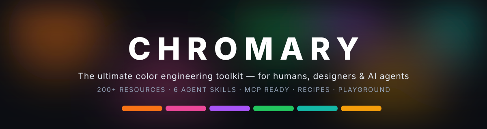

<!-- 🚀 PUBLISH TIP: after you create the GitHub repo, find & replace YOUR_USERNAME with your actual GitHub username. -->

<div align="center">



# 🔥 Chroma Forge

**The most complete color engineering toolkit on GitHub — for humans, designers & AI agents.**

[](./LICENSE)
[](./CONTRIBUTING.md)
[](#-the-vault)
[](./skills)
[](./mcp)
[](./web)

**[200+ resources](#-the-vault) · [16 deep-dive guides](./docs) · [6 installable AI-agent skills](./skills) · [MCP server starter](./mcp) · [9 copy-paste recipes](./recipes) · [Live playground](./live-playground)**

[Quickstart](#-30-second-quickstart) · [Task Router](#-find-what-you-need-in-5-seconds) · [The Vault](#-the-vault) · [Skills](#-ai-agent-skills) · [Roadmap](#-roadmap)

</div>

---

## 🤔 What is this?

Great color work is scattered across a hundred browser tabs: an API here, a WCAG calculator there, a colormap guide in a PDF from 2020. **Chroma Forge fuses all of it into one curated, opinionated, agent-ready hub:**

- 🧭 **The Vault** — 200+ hand-picked tools, APIs, libraries, papers and standards, organized into **16 deep-dive guides**, each with a 🏆 TL;DR table and ⭐ ratings
- 🤖 **Agent Skills** — 6 drop-in [`SKILL.md`](https://agent-skills.dev) skills that teach any AI agent (Claude Code, Cursor, Windsurf…) to generate palettes, audit contrast, build themes, and pick scientific colormaps
- 🔌 **MCP-Ready** — a curated registry **plus a working [Model Context Protocol](https://modelcontextprotocol.io) server** so agents can call color APIs as native tools
- 🧪 **Recipes** — 9 copy-paste JavaScript, Python and CSS snippets that just work (OKLCH scales, APCA contrast, mesh gradients…)
- 🎮 **Live Playground** — a zero-dependency HTML demo: palette generator, contrast checker, gradient gallery (deployable to GitHub Pages in one click)

> If this repo saves you a tab — or a hundred — consider giving it a ⭐.

## 🧭 Find what you need in 5 seconds

| I want to… | Go here | Invoke this skill |
|---|---|---|
| Pick a palette that *just works* | [08 · AI palette generation](docs/08-ai-palette-generation.md) | `palette-generator` |
| Make my UI pass WCAG & APCA | [04 · Accessibility & contrast](docs/04-accessibility-contrast.md) | `contrast-auditor` |
| Build a Tailwind / shadcn theme | [05 · Design systems & scales](docs/05-design-systems-and-scales.md) | `theme-builder` |
| Chart scientific data correctly | [06 · Data-viz colormaps](docs/06-data-visualization-colormaps.md) | `dataviz-colormaps` |
| Make buttery, never-gray gradients | [07 · CSS gradients](docs/07-css-gradients.md) | `gradient-smith` |
| Extract colors from a logo/image | [10 · Image color extraction](docs/10-image-color-extraction.md) | `image-palette` |
| Wire color tools into an AI agent | [mcp/](./mcp) + [02 · Agent skills](docs/02-ai-agent-skills.md) | — |
| Finally understand OKLCH | [03 · Perceptual color spaces](docs/03-perceptual-color-spaces.md) | — |
| Match a Pantone / RAL color | [12 · Print & physical standards](docs/12-print-and-physical-standards.md) | — |
| Nail a pixel-art palette | [14 · Game & pixel palettes](docs/14-game-and-pixel-palettes.md) | — |
| Choose a color library | [11 · Libraries & SDKs](docs/11-libraries-and-sdks.md) | — |
| Read the actual color science | [13 · Science & standards](docs/13-color-science-and-standards.md) | — |
| Skim the vocabulary | [16 · Glossary](docs/16-glossary.md) | — |

## ⚡ 30-Second Quickstart

**🧑‍🎨 Humans** — browse [The Vault](#-the-vault), open a guide, use its 🏆 TL;DR table. Done.

**🤖 AI agents** — install all 6 skills into Claude Code (or any `SKILL.md`-aware runtime):

```bash
git clone https://github.com/YOUR_USERNAME/chroma-forge.git
mkdir -p .claude/skills
cp -r chroma-forge/skills/* .claude/skills/
```

**🔌 MCP** — give your agent live color tools in one command:

```bash
cd chroma-forge/mcp/example-color-server
bun install && bun run index.ts
```

**🧪 Developers** — steal a recipe:

```js
// recipes/javascript/perceptual-scale.js — an OKLCH scale in ~10 lines
import { oklch, formatHex } from 'culori';
```

## 🗺️ The Vault

Sixteen deep-dive guides. Every guide has a 🏆 TL;DR table, a full catalog with pro tips, pitfalls, and a runnable "try it now" snippet.

| # | Guide | What's inside |
|---|---|---|
| 01 | [🔌 REST APIs & MCP](docs/01-rest-apis-and-mcp.md) | The Color API, color.pizza, Colormind, APIVerve, x-colors + MCP in 2 minutes |
| 02 | [🤖 AI Agent Skills](docs/02-ai-agent-skills.md) | The open SKILL.md format, progressive disclosure, writing skills agents actually use |
| 03 | [🧭 Perceptual Color Spaces](docs/03-perceptual-color-spaces.md) | OKLCH/OKLab, CIE Lab/LCH, HSLuv, HCT, CAM16, gamut mapping |
| 04 | [♿ Accessibility & Contrast](docs/04-accessibility-contrast.md) | WCAG 2.1 math, APCA/WCAG 3, color-blind simulation, auto-fix strategies |
| 05 | [🎛️ Design Systems & Scales](docs/05-design-systems-and-scales.md) | Tailwind 50–950, Radix 12-step, shadcn tokens, Material 3 HCT, 10 enterprise systems |
| 06 | [📊 Data-Viz Colormaps](docs/06-data-visualization-colormaps.md) | viridis, Crameri scientific maps, ColorBrewer, iwanthue, when jet attacks |
| 07 | [🌈 CSS Gradients](docs/07-css-gradients.md) | Perceptual interpolation in OKLab, mesh gradients, grainy overlays, shader gradients |
| 08 | [🪄 AI Palette Generation](docs/08-ai-palette-generation.md) | Huemint, Khroma, Colormind, ColorMagic + LLM prompting patterns that respect contrast |
| 09 | [🌍 Inspiration, Culture & Themes](docs/09-inspiration-culture-and-themes.md) | Brand colors, Japanese & Chinese traditional palettes, dev themes (Catppuccin, Nord…) |
| 10 | [🖼️ Image Color Extraction](docs/10-image-color-extraction.md) | Color Thief, Vibrant, fast-average-color, k-means recipes |
| 11 | [🧰 Libraries & SDKs](docs/11-libraries-and-sdks.md) | culori, colorjs.io, chroma.js, colord · coloraide, colour-science · palette, go-colorful |
| 12 | [🖨️ Print & Physical Standards](docs/12-print-and-physical-standards.md) | Pantone, RAL, NCS, Coloro, Munsell, CMYK workflows |
| 13 | [🔬 Color Science & Standards](docs/13-color-science-and-standards.md) | CIE, ICC, ΔE2000, CSS Color 4/5, the papers worth reading |
| 14 | [👾 Game & Pixel Palettes](docs/14-game-and-pixel-palettes.md) | Lospec, PICO-8, Sweetie 16, ENDESGA, dithering |
| 15 | [🎯 Tool Selection Matrix](docs/15-tool-selection-matrix.md) | One giant table: task → first choice → alternative → skill → guide |
| 16 | [📚 Glossary](docs/16-glossary.md) | Hue, chroma, gamut, metamerism, ΔE, Lc — everything in plain English |

## 🤖 AI Agent Skills

Each skill is a folder with a `SKILL.md` in the open agent-skills format: a YAML frontmatter (`name` + `description`) plus battle-tested instructions. Agents read the `description` to decide *when* to load the skill — so install them and just ask naturally.

| Skill | Fire it when the user says… |
|---|---|
| [`palette-generator`](skills/palette-generator/SKILL.md) | "give me a palette", "brand colors", "colors that match #0EA5A0" |
| [`contrast-auditor`](skills/contrast-auditor/SKILL.md) | "is this accessible?", "fix this contrast", "WCAG check" |
| [`theme-builder`](skills/theme-builder/SKILL.md) | "build me a shadcn/tailwind theme from this color" |
| [`dataviz-colormaps`](skills/dataviz-colormaps/SKILL.md) | "which colormap for my heatmap?", "CVD-safe chart colors" |
| [`gradient-smith`](skills/gradient-smith/SKILL.md) | "make a gradient", "why is my gradient gray in the middle?" |
| [`image-palette`](skills/image-palette/SKILL.md) | "extract colors from this logo/screenshot" |

```bash
# per-project (recommended)
mkdir -p .claude/skills && cp -r skills/* .claude/skills/

# global for every project
mkdir -p ~/.claude/skills && cp -r skills/* ~/.claude/skills/
```

> 💡 **Anatomy of a good skill description:** *what it does* + *when to use it* + trigger keywords. That single line decides whether your agent finds it.

## 🔌 MCP — Model Context Protocol

Give agents *live* color capabilities instead of memorized hex codes.

| Resource | What it does |
|---|---|
| [MCP registry & setup guide](mcp/README.md) | Curated color MCP servers + copy-paste configs for Claude Desktop, Cursor & VS Code |
| [`example-color-server`](mcp/example-color-server/index.ts) | Working starter MCP server (TypeScript, runs with Bun): `generate_palette` + `color_info` tools powered by The Color API |

```jsonc
// claude_desktop_config.json / .cursor/mcp.json
{
  "mcpServers": {
    "chroma-forge": {
      "command": "bun",
      "args": ["run", "/absolute/path/to/chroma-forge/mcp/example-color-server/index.ts"]
    }
  }
}
```

## 🧪 Recipes

Battle-tested, dependency-light, copy-paste-ready.

| Recipe | Lang | Superpower |
|---|---|---|
| [`perceptual-scale.js`](recipes/javascript/perceptual-scale.js) | JS | Tailwind-style 50–950 scale from one hue, in OKLCH |
| [`wcag-apca-contrast.js`](recipes/javascript/wcag-apca-contrast.js) | JS | WCAG ratio + APCA Lc in one file |
| [`gradient-interpolation.js`](recipes/javascript/gradient-interpolation.js) | JS | Gray-free ramps interpolated in OKLab |
| [`image-palette.js`](recipes/javascript/image-palette.js) | JS | Extract a role-based palette from any image |
| [`scientific-colormaps.py`](recipes/python/scientific-colormaps.py) | 🐍 | Publication-grade plots with Crameri maps |
| [`distinct-categorical-colors.py`](recipes/python/distinct-categorical-colors.py) | 🐍 | N maximally-distinguishable categorical colors |
| [`oklch-brand-scale.css`](recipes/css/oklch-brand-scale.css) | CSS | Copy-paste OKLCH token scale (50→950) |
| [`mesh-gradient.css`](recipes/css/mesh-gradient.css) | CSS | Buttery mesh gradient, zero images |
| [`shadcn-theme-tokens.css`](recipes/css/shadcn-theme-tokens.css) | CSS | Complete shadcn-style semantic tokens in OKLCH |

## 🎮 Live Playground

[`web/index.html`](web/index.html) is a **single self-contained file** — no build, no npm, no framework:

- 🎲 Palette generator (analogic / complement / triadic modes, click-to-copy swatches)
- ♿ WCAG contrast checker with live AA/AAA verdicts
- 🌈 Six perceptual gradient cards with copy-CSS buttons
- 🤖 Cards linking to every agent skill

**Deploy it free:** repo Settings → Pages → Source: **GitHub Actions** → done (the included [`.github/workflows/pages.yml`](.github/workflows/pages.yml) handles the rest).

## ⭐ Rating Legend

| Stars | Meaning |
|---|---|
| ★★★★★ | Must-know. Industry standard. Start here. |
| ★★★★ | Excellent — best-in-class for its niche |
| ★★★ | Solid — great for specific scenarios |
| ★★ | Situational / legacy but useful |
| ★ | Historical or niche, listed for completeness |

## 🏗️ Repo Map

```text
chroma-forge/
├── README.md                 ← you are here
├── docs/                     ← 16 deep-dive guides (The Vault)
├── skills/                   ← 6 AI-agent skills (SKILL.md format)
├── mcp/                      ← MCP registry + working example server
├── recipes/                  ← javascript/ · python/ · css/
├── web/                      ← zero-dependency live playground
├── assets/                   ← banner & art
└── .github/                  ← templates, funding, Pages workflow
```

## 🗺️ Roadmap

- [x] **v1.0** — The Vault (16 guides) · 6 agent skills · MCP starter · 9 recipes · playground
- [ ] **v1.1** — 6 more skills: `cvd-simulator`, `print-matcher`, `token-linter`, `theme-migrator`, `brand-auditor`, `cultural-palette`
- [ ] **v1.2** — interactive colormap lab (WASM) & CVD-simulated playground toggle
- [ ] **v1.3** — community resource-of-the-month vote + auto link-checker CI

## 🤝 Contributing

PRs are extremely welcome — adding a resource takes 2 minutes. Read [CONTRIBUTING.md](CONTRIBUTING.md) for the format (one table row + one catalog entry + a verified link), the rating rules, and how to propose a new skill.

## 🛡️ Code of Conduct

Be excellent to each other. See [CODE_OF_CONDUCT.md](CODE_OF_CONDUCT.md).

## 📄 License

[MIT](./LICENSE) — free forever, for humans and agents alike.

## 💖 Acknowledgements

Standing on the shoulders of giants: **Björn Ottosson** (OKLab/OKLCH), **Myndex** (APCA), **Fabio Crameri** (scientific colormaps), **Cynthia Brewer** (ColorBrewer), the maintainers of **culori, colorjs.io, chroma.js, coloraide**, the **Catppuccin / Nord / Dracula / Rosé Pine** theme teams, **Lospec**, and every palette nerd who ever argued about gray dead-zones.

---

<div align="center">

<b>🔥 Chroma Forge</b> — forged for humans, tuned for agents.<br/>
<sub>Made with ⚡ and 200+ tabs closed forever.</sub>

</div>
